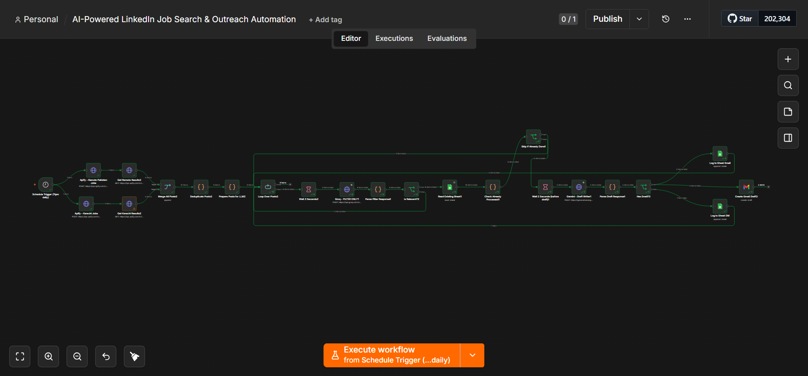
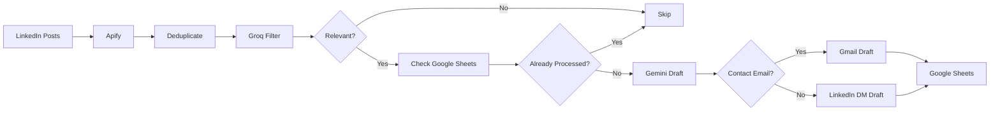

# 🤖 AI-Powered LinkedIn Job Search & Outreach Automation

> **AI-powered job discovery, filtering, and personalized outreach — automated with n8n.**

An end-to-end **human-in-the-loop AI automation** that discovers LinkedIn job posts, removes duplicates, filters relevant opportunities with Groq, generates personalized email/LinkedIn DM drafts, and tracks everything in Google Sheets.

## 📸 Workflow Overview



*Complete 25+ node n8n automation workflow.*

---

## ⚡ What It Does

| Stage               | Automation                                   |
| ------------------- | -------------------------------------------- |
| 🔎 **Discover**     | Scrapes LinkedIn job posts using Apify       |
| 🧹 **Deduplicate**  | Removes repeated posts and hiring duplicates |
| 🧠 **Filter**       | Groq evaluates role, location & experience   |
| ✍️ **Personalize**  | Gemini creates tailored email/DM drafts      |
| 📊 **Track**        | Google Sheets stores jobs, drafts & statuses |
| 👤 **Human Review** | Gmail drafts are reviewed before sending     |

### 🔄 Workflow



---

## 🛠️ Tech Stack

| Component     | Technology             |
| ------------- | ---------------------- |
| Automation    | **n8n**                |
| Scraping      | **Apify**              |
| AI Filtering  | **Groq — GPT-OSS-20B** |
| AI Drafting   | **Google Gemini**      |
| Data Tracking | **Google Sheets**      |
| Email         | **Gmail API**          |

---

## ✨ Key Features

* **Automated LinkedIn job discovery** for Karachi & remote opportunities
* **LLM-powered relevance filtering** to reduce unnecessary processing
* **Duplicate detection** to avoid processing the same opportunity repeatedly
* **Personalized outreach** based on the job description and candidate profile
* **Email + LinkedIn DM generation**
* **Persistent Google Sheets tracking** with email/DM status
* **Human-in-the-loop workflow** — AI prepares, human approves

---

## 📊 Example Output

| Company  | Role                           | Match | Type        | Status      |
| -------- | ------------------------------ | ----: | ----------- | ----------- |
| ARYtech  | Associate AI Software Engineer |  9/10 | Email       | Draft Ready |
| Maxtrone | AI/ML Engineer                 |  8/10 | Email       | Draft Ready |
| Xperlabs | AI Engineer                    |  7/10 | LinkedIn DM | DM Ready    |

---

## 🧩 Project Highlights

This workflow demonstrates practical experience with:

**AI Automation** · **LLM Integration** · **n8n** · **Prompt Engineering** · **API Integration** · **Web Scraping** · **Google Workspace Automation** · **Data Deduplication** · **Human-in-the-Loop AI**

---

## 🚀 Setup

### Requirements

* n8n
* Apify
* Groq API
* Gemini API
* Google Sheets OAuth
* Gmail OAuth

### Quick Start

```text
1. Import workflow.json into n8n
2. Configure API credentials
3. Connect Google Sheets & Gmail
4. Configure the target job searches
5. Activate the workflow
```

### Google Sheets Structure

```text
Date | Company | Role | Location | Experience | Match Score |
Type | Contact Email | Author Name | Post URL | Apply Link |
Email Draft | DM Draft | Email Status | DM Status
```

---

## 🔐 Human-in-the-Loop

The automation **does not automatically send applications**.

> **AI discovers → filters → drafts → human reviews → human sends**

This keeps the workflow efficient while maintaining control over every outreach message.

---

## 👩‍💻 Author

**Waariha Asim Sheikh**
AI Engineer | Generative AI | AI Automation

[GitHub](https://github.com/Waariha-Asim) · [LinkedIn](https://linkedin.com/in/waarihaasim)

---

⭐ **Built with n8n, Groq, Gemini & Google Workspace**
